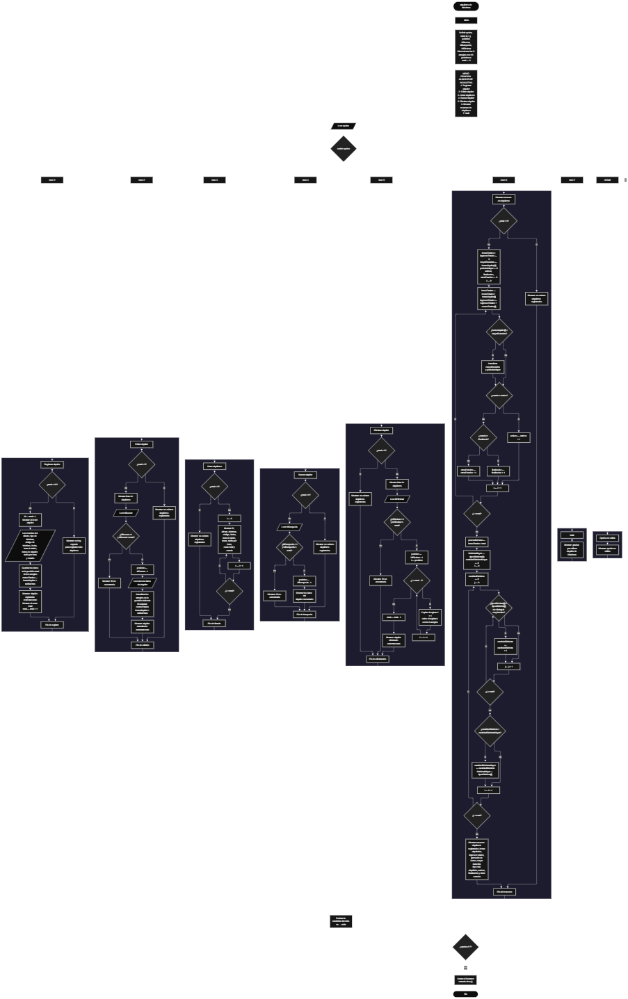

Este proyecto, llamado <b>alquileres de bicicletas</b>, fue desarrollado en <b>java</b> como un ejercicio práctico para fortalecer la lógica de programación mediante la creación de un sistema de control de alquileres de bicicletas desde la consola. El programa cuenta con un menú principal de siete opciones que permite <b>registrar, editar, listar, buscar, eliminar y mostrar el resumen</b> de los alquileres almacenados. Cada alquiler guarda datos como el nombre del cliente, el tipo de bicicleta, el código de la bicicleta, la fecha, la hora de inicio, las horas de alquiler, la tarifa por hora, el costo total y el estado, utilizando arreglos con una capacidad máxima de <b>10 alquileres durante la ejecución</b>. A diferencia de un registro simple, el programa <b>calcula automáticamente el costo total</b> a partir de las horas y la tarifa, y en el resumen identifica el <b>tipo de bicicleta más alquilado</b>. Durante su desarrollo se aplicaron conceptos fundamentales de programación, como variables, arreglos, estructuras condicionales, ciclos repetitivos, ciclos anidados, estructuras de selección y operaciones matemáticas, además de procesos para buscar, modificar, eliminar y calcular estadísticas sobre los registros. Este proyecto permite poner en práctica los conocimientos adquiridos en java y sirve como base para desarrollar sistemas de gestión más avanzados utilizando clases, colecciones y otras tecnologías.

<h2 align="center">⚙️ Funcionamiento del menú principal</h2>

### ➕ Registrar alquiler

La opción <b>1) registrar alquiler</b> permite agregar un nuevo alquiler al sistema. Antes de realizar el registro, el programa comprueba que haya espacio disponible mediante la condición <b>total &gt;= clientes.length</b>. Si el arreglo está lleno, muestra el mensaje <b>"No hay espacio para registrar mas alquileres."</b> y regresa al menú. Si existe espacio, genera automáticamente el <b>id</b> del alquiler (<b>total + 1</b>), lo muestra en pantalla y solicita el <b>nombre del cliente, tipo de bicicleta, código de bicicleta, fecha del alquiler, hora de inicio, horas de alquiler, tarifa por hora y estado</b>. Con las horas y la tarifa calcula el <b>costo total</b> mediante la fórmula <b>horas de alquiler × tarifa por hora</b> y lo guarda en su propio arreglo. Los datos se almacenan en la posición <b>total</b> de sus respectivos arreglos. Después de leer los valores numéricos, el programa usa <b>entrada.nextLine()</b> para limpiar el salto de línea pendiente en el buffer. Finalmente, muestra el mensaje <b>"Alquiler registrado correctamente."</b>, presenta el costo total y aumenta la variable <b>total</b> en uno.

### ✏️ Editar alquiler

La opción <b>2) editar alquiler</b> permite modificar la información de un alquiler registrado. Primero, el programa comprueba si existen alquileres almacenados mediante la variable <b>total</b>. Si no hay registros, muestra el mensaje <b>"No existen alquileres registrados."</b>. En caso contrario, presenta una lista con todos los datos de cada alquiler y solicita el ID del que se desea editar. Después, comprueba que el ID esté dentro del rango permitido mediante la condición <b>idBuscar &gt;= 1 y idBuscar &lt;= total</b>. Si la selección es válida, calcula la posición (<b>idBuscar - 1</b>) y solicita nuevamente los datos del alquiler, sobrescribiendo los valores de los arreglos correspondientes. Con las nuevas horas y tarifa, <b>recalcula el costo total</b> para que no quede desactualizado. Finalmente, presenta el mensaje <b>"Alquiler actualizado correctamente."</b>. Si el ID no corresponde a un alquiler registrado, informa <b>"ID no encontrada."</b>.

### 📋 Listar alquileres

La opción <b>3) listar alquileres</b> permite visualizar todos los alquileres registrados actualmente. Antes de mostrar la información, el programa comprueba si la variable <b>total</b> es igual a cero. Si no existen registros, presenta el mensaje <b>"No existen alquileres registrados."</b>. Si hay alquileres disponibles, utiliza un ciclo <b>for</b> para recorrer los arreglos desde la posición 0 hasta <b>total - 1</b>. Durante el recorrido, muestra en una sola línea el ID, el cliente, la bicicleta, el código, la fecha, la hora de inicio, las horas, la tarifa por hora, el costo total y el estado de cada registro. Esta función facilita consultar los datos existentes sin necesidad de buscar cada alquiler individualmente.

### 🔎 Buscar alquiler

La opción <b>4) buscar alquiler</b> permite localizar un alquiler mediante su ID. Primero, el programa comprueba si existen alquileres registrados. Si no los hay, muestra el mensaje <b>"No existen alquileres registrados."</b>. En caso contrario, solicita el ID que se desea buscar y verifica que esté dentro del rango válido (<b>idBusqueda &gt;= 1 y idBusqueda &lt;= total</b>). Si el ID es válido, calcula la posición correspondiente (<b>idBusqueda - 1</b>) y muestra los datos completos del alquiler encontrado. Si el ID está fuera del rango, presenta el mensaje <b>"ID no encontrada."</b>. La búsqueda accede directamente a la posición del arreglo, por lo que no necesita recorrerlo completo.

### 🗑️ Eliminar alquiler

La opción <b>5) eliminar alquiler</b> permite eliminar un alquiler registrado mediante su ID. Antes de comenzar, el programa comprueba que existan alquileres almacenados. Si no hay registros, muestra el mensaje <b>"No existen alquileres registrados."</b>. Si hay datos disponibles, presenta la lista completa de alquileres y solicita el ID del que se desea eliminar. Después, verifica que la selección esté dentro del rango válido. Si el alquiler existe, utiliza un ciclo <b>for</b> que comienza en la posición seleccionada y llega hasta <b>total - 2</b>, copiando en cada repetición los datos de la posición siguiente sobre la actual en los nueve arreglos. De esta manera se mantienen los arreglos paralelos sincronizados y sin espacios vacíos. Posteriormente, disminuye la variable <b>total</b> en uno y muestra el mensaje <b>"Alquiler eliminado correctamente."</b>. Si el ID no corresponde a un alquiler registrado, informa <b>"ID no encontrada."</b>.

### 📊 Mostrar resumen de alquileres

La opción <b>6) mostrar resumen de alquileres</b> calcula y presenta un resumen estadístico de todos los alquileres registrados. Primero, el programa comprueba si existen registros; si no los hay, muestra el mensaje <b>"No existen alquileres registrados."</b>. En caso contrario, inicializa los acumuladores y recorre los arreglos con un ciclo <b>for</b>, sumando las <b>horas totales</b> y los <b>ingresos totales</b>, que se obtienen sumando los costos ya calculados de cada alquiler. Durante el mismo recorrido, compara las horas para identificar la <b>mayor duración</b>, guardando también su posición para poder mostrar el nombre del cliente correspondiente. Además, cuenta los alquileres según su estado usando <b>equalsIgnoreCase</b>: <b>"Activo"</b>, <b>"Finalizado"</b> u otros estados. Después, calcula el promedio de horas dividiendo las horas totales entre <b>total</b> y determina el <b>tipo de bicicleta más alquilado</b> mediante dos ciclos anidados. Con todos los valores calculados, presenta el resumen completo en pantalla.

### 🚪 Salir del menú principal

La opción <b>7) salir</b> finaliza la ejecución del programa y muestra el mensaje <b>"Gracias por utilizar Alquiler de Bicicletas."</b>. El menú principal se encuentra dentro de una estructura repetitiva <b>do ... while</b>, cuya condición es <b>opcion != 7</b>. De esta forma, el programa se mantiene en funcionamiento mientras el usuario realiza operaciones y termina únicamente cuando selecciona la opción de salida. Al finalizar el ciclo, el programa cierra el objeto <b>Scanner</b> con <b>entrada.close()</b>.

<h2 align="center">🧠 Temas aplicados en el proyecto</h2>

### 📦 Variables

En este proyecto se utilizan variables para guardar la opción seleccionada en el menú, controlar la cantidad de alquileres registrados, recorrer los arreglos, seleccionar los alquileres que se desean editar, buscar o eliminar, y almacenar los valores calculados en el resumen. Cada variable cumple una función específica dentro de las operaciones de gestión de alquileres.

🔢 **opcion:** Almacena la opción seleccionada por el usuario en el menú principal.

📊 **total:** Almacena la cantidad actual de alquileres registrados.

🆔 **id:** Almacena el identificador automático asignado al registrar un alquiler.

🔍 **idBuscar, idBusqueda, idEliminar:** Almacenan el ID introducido por el usuario para editar, buscar o eliminar un alquiler.

📍 **posicion:** Almacena la posición real del alquiler dentro de los arreglos (ID - 1).

🔄 **i, j:** Funcionan como contadores en los ciclos **for**; `i` recorre los alquileres y `j` se usa en el ciclo interno que cuenta los tipos de bicicleta.

🕒 **horasTotales:** Acumula las horas alquiladas en todos los registros.

💰 **ingresosTotales:** Acumula el costo total de todos los alquileres.

🏆 **mayorDuracion, posicionMayor:** Guardan la mayor cantidad de horas alquiladas y la posición del cliente que la tiene.

✅ **activos, finalizados, otrosEstados:** Contadores que clasifican los alquileres según su estado.

📈 **promedioHoras:** Almacena el promedio de horas de alquiler.

🚲 **bicicletaMayor, cantidadBicicletaMayor, cantidadBicicleta:** Se utilizan para determinar el tipo de bicicleta que más veces aparece en los registros.

### 🗃️ Arreglos

En este proyecto se utilizan nueve arreglos paralelos relacionados con los datos de cada alquiler. Cada arreglo tiene una capacidad de <b>10 posiciones</b> y utiliza el mismo índice para representar la información correspondiente a un mismo alquiler. Por ejemplo, los datos de un alquiler almacenado en la posición <b>0</b> se encuentran distribuidos entre <b>clientes[0], tiposBicicleta[0], codigosBicicleta[0], fechas[0], horasInicio[0], horasAlquiler[0], tarifasHora[0], costosTotales[0] y estados[0]</b>. Esta organización permite recorrer, buscar, modificar, mostrar y eliminar los alquileres de manera ordenada.

👤 **clientes[10]:** Almacena el nombre de cada cliente.

🚲 **tiposBicicleta[10]:** Almacena el tipo de bicicleta alquilada.

🔖 **codigosBicicleta[10]:** Almacena el código de la bicicleta.

📅 **fechas[10]:** Almacena la fecha del alquiler.

⏰ **horasInicio[10]:** Almacena la hora de inicio del alquiler.

🕒 **horasAlquiler[10]:** Almacena las horas de alquiler (arreglo decimal, por lo que admite valores como 1.5).

💲 **tarifasHora[10]:** Almacena la tarifa por hora.

🧮 **costosTotales[10]:** Almacena el costo total calculado por el programa.

🏷️ **estados[10]:** Almacena el estado del alquiler.

### 🔀 Estructuras condicionales

En este proyecto se utilizan las estructuras <b>if</b>, <b>else if</b> y <b>else</b> para comprobar si existe espacio antes de registrar un alquiler, verificar si existen registros antes de realizar determinadas operaciones, validar el ID seleccionado para editar, buscar o eliminar, comparar las horas para encontrar la mayor duración, clasificar los alquileres según su estado y decidir cuál es el tipo de bicicleta que más se repite. Estas condiciones permiten que el programa responda de manera diferente según el contenido de los arreglos y el resultado de cada operación.

### 🔄 Estructuras repetitivas

En este proyecto se utilizan los ciclos <b>for</b> y <b>do ... while</b>. Los ciclos <b>for</b> permiten recorrer los arreglos para mostrar los alquileres, calcular las estadísticas del resumen y, durante la eliminación, desplazar los datos de los alquileres posteriores una posición hacia atrás. Por otro lado, el ciclo <b>do ... while</b> mantiene activo el menú principal para que el usuario pueda ejecutar diferentes operaciones antes de salir del programa.

### 🎯 Estructura switch

El programa evalúa el valor almacenado en la variable <b>opcion</b> mediante la estructura <b>switch</b> y ejecuta el bloque de instrucciones correspondiente. Cada <b>case</b> representa una operación específica del sistema: <b>registrar, editar, listar, buscar, eliminar, mostrar resumen o salir</b>. También se utiliza el bloque <b>default</b> para mostrar el mensaje <b>"Opcion no valida."</b> cuando el valor introducido no coincide con ninguna de las opciones definidas.

### 🔢 Dimensionamiento de arreglos

El programa utiliza la instrucción <b>new</b> para establecer la capacidad de los arreglos que almacenan la información de los alquileres, por ejemplo <b>new String[10]</b> o <b>new double[10]</b>. Se definieron <b>10 posiciones</b> para cada arreglo, lo que permite administrar hasta 10 alquileres durante la ejecución. La cantidad de posiciones ocupadas se controla mediante la variable <b>total</b>, por lo que las operaciones recorren únicamente los registros comprendidos entre la posición 0 y <b>total - 1</b>.

### 🔄 Reorganización de registros

Cuando se selecciona un alquiler para eliminarlo, el programa utiliza un ciclo <b>for</b> que comienza en la posición seleccionada y llega hasta <b>total - 2</b>. En cada repetición, los datos de la posición siguiente se copian sobre la posición actual en los nueve arreglos. Después, la variable <b>total</b> disminuye en uno, de modo que la última posición deja de considerarse parte de los registros activos y queda disponible para ser sobrescrita en un nuevo registro. De esta manera, los alquileres posteriores ocupan las posiciones libres sin dejar espacios vacíos entre los registros activos.

### 🔁 Ciclos anidados y tipo de bicicleta más alquilado

En el resumen se utilizan dos ciclos <b>for</b> anidados para determinar el tipo de bicicleta más alquilado, es decir, el valor que más veces se repite en el arreglo <b>tiposBicicleta</b>. El ciclo externo, controlado por <b>i</b>, toma cada tipo registrado. El ciclo interno, controlado por <b>j</b>, recorre todos los registros y cuenta cuántas veces aparece ese tipo mediante <b>equalsIgnoreCase</b>, por lo que no distingue entre mayúsculas y minúsculas. Si el conteo obtenido supera al mayor conteo guardado hasta ese momento, el programa actualiza las variables <b>cantidadBicicletaMayor</b> y <b>bicicletaMayor</b>. Este cálculo se realiza antes de imprimir el resumen, de modo que la presentación de los resultados queda separada del proceso de cálculo.

### 🧮 Cálculos y operaciones matemáticas

Este proyecto aplica operaciones matemáticas sobre los datos ingresados. El <b>costo total</b> de cada alquiler se calcula multiplicando las horas de alquiler por la tarifa por hora, y se recalcula cada vez que se edita un alquiler. En el resumen, los <b>ingresos totales</b> se obtienen sumando los costos ya calculados, y el <b>promedio de horas</b> se calcula dividiendo las horas totales entre la cantidad de alquileres registrados. También se utilizan operadores de asignación compuesta como <b>+=</b> y <b>++</b> para acumular valores y contar estados, y la comparación <b>&gt;</b> para encontrar la mayor duración.

<h2 align="center">¿Cómo se implementaron las operaciones crud en el proyecto?</h2>

Las operaciones <b>crud</b> se implementaron mediante las opciones del menú principal, permitiendo administrar los alquileres registrados. La operación <b>crear</b> corresponde a <b>registrar alquiler</b>, donde se introducen los datos de un nuevo alquiler; <b>leer</b> se realiza mediante las opciones <b>listar alquileres, buscar alquiler y mostrar resumen de alquileres</b>; <b>actualizar</b> corresponde a <b>editar alquiler</b>, donde se modifican los datos de un alquiler registrado y se recalcula el costo total; y <b>eliminar</b> se realiza mediante la opción <b>eliminar alquiler</b>. Estas operaciones utilizan variables, arreglos, condicionales y ciclos para gestionar la información almacenada temporalmente durante la ejecución del programa.

<h2 align="center">Diagrama de flujo del proyecto</h2>

<h2 align="center">🛡️ Validaciones del programa</h2>

### 📭 No existen alquileres registrados

Esta validación se utiliza en las opciones de <b>editar, listar, buscar, eliminar y mostrar resumen de alquileres</b>. El programa comprueba si la variable <b>total</b> es igual a <b>0</b> y, si no existen alquileres registrados, muestra el mensaje <b>"No existen alquileres registrados."</b>. Esta comprobación evita continuar con las operaciones que necesitan información almacenada cuando el sistema está vacío. En el caso del resumen, además evita acceder a la posición 0 de los arreglos y dividir entre cero al calcular el promedio.

### ⚠️ Sin espacio para registrar

Esta validación se utiliza durante el registro de nuevos alquileres para controlar la capacidad máxima de los arreglos. El programa comprueba si <b>total &gt;= clientes.length</b> antes de permitir agregar un nuevo registro. Si el arreglo está lleno, muestra el mensaje <b>"No hay espacio para registrar mas alquileres."</b> y regresa al menú, impidiendo registrar más alquileres mientras se mantenga la capacidad máxima.

### ❌ ID no encontrada

Esta validación se utiliza en las opciones de editar, buscar y eliminar. El programa comprueba que el ID introducido sea mayor o igual a <b>1</b> y menor o igual al valor de <b>total</b>. Si la selección está fuera de ese rango, muestra el mensaje <b>"ID no encontrada."</b>. Esta validación evita modificar, consultar o eliminar posiciones que no corresponden a alquileres registrados.

### ⚠️ Opción inválida

La estructura <b>switch</b> incluye el bloque <b>default</b>, que muestra el mensaje <b>"Opcion no valida."</b> cuando el usuario introduce un número que no corresponde a ninguna de las opciones definidas en el menú. Como la condición de salida del ciclo es <b>opcion != 7</b>, el menú se vuelve a mostrar y el usuario puede elegir una opción correcta.

<h2 align="center">🔧 Aspectos a mejorar</h2>

Aunque el programa cumple con todas las operaciones planteadas, se identificaron algunos puntos que pueden mejorarse en futuras versiones. Primero, el ID de cada alquiler se calcula a partir de su posición (<b>posición + 1</b>), por lo que al eliminar un alquiler los IDs de los siguientes se recorren una posición. Segundo, el programa no valida el tipo de dato ingresado, por lo que si el usuario escribe letras donde se espera un número, se produce una <b>InputMismatchException</b> y la ejecución se detiene. Tercero, tampoco valida los rangos de los valores, por lo que acepta horas o tarifas negativas, o alquileres de cero horas. Cuarto, el código de la bicicleta se guarda como texto, pero el programa no controla la disponibilidad, por lo que permite registrar la misma bicicleta en dos alquileres activos al mismo tiempo. Quinto, el código de bicicleta, la fecha y la hora de inicio solo se guardan y se muestran, sin intervenir en ningún cálculo, y la fecha y la hora no se validan en su formato. Además, la tarifa, el costo total y los ingresos se muestran sin indicar la moneda, y si dos tipos de bicicleta se repiten la misma cantidad de veces, el programa muestra solo el primero sin informar del empate. Por último, la línea que imprime los datos de un alquiler se repite en varias opciones y podría moverse a un método reutilizable, al igual que el cálculo del tipo más alquilado, y el programa podría reorganizarse en una clase <b>Alquiler</b> con colecciones como <b>ArrayList</b> para eliminar el límite fijo de 10 registros.

<h2 align="center">🎯 Objetivo del proyecto</h2>

El objetivo principal de este proyecto es fortalecer la <b>lógica de programación</b> mediante el desarrollo de un sistema de control de alquileres de bicicletas en <b>java</b>. A través de su construcción se busca aplicar los conocimientos adquiridos sobre variables, arreglos, estructuras condicionales, ciclos repetitivos, ciclos anidados, estructuras de selección y operaciones matemáticas, integrándolos para resolver un problema de manera organizada. Además, el proyecto permite comprender cómo registrar, consultar, modificar, eliminar y analizar información en una aplicación de consola, estableciendo una base para desarrollar sistemas de gestión más completos con otros lenguajes y tecnologías.

